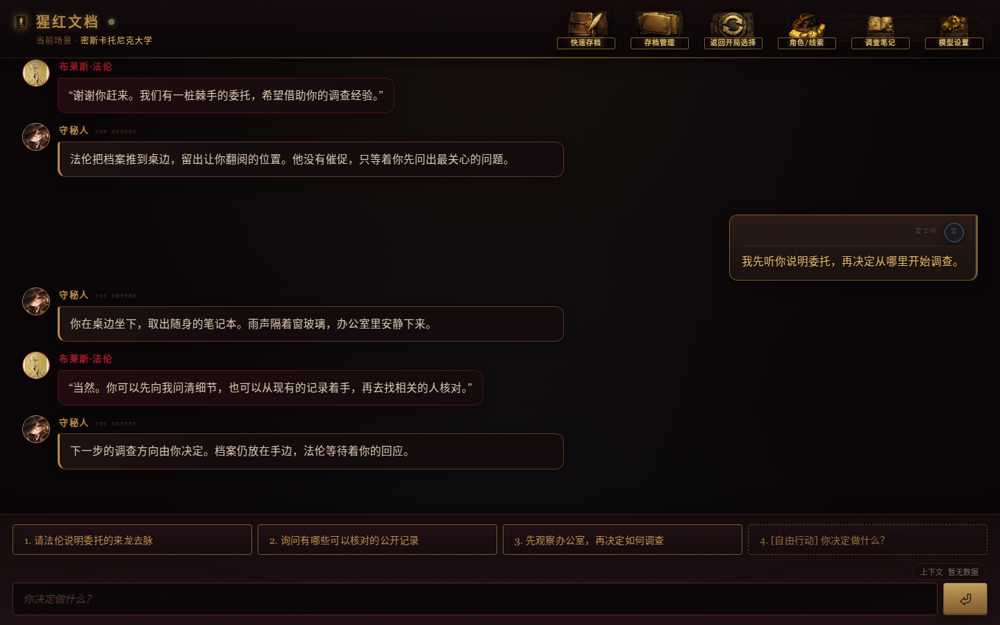
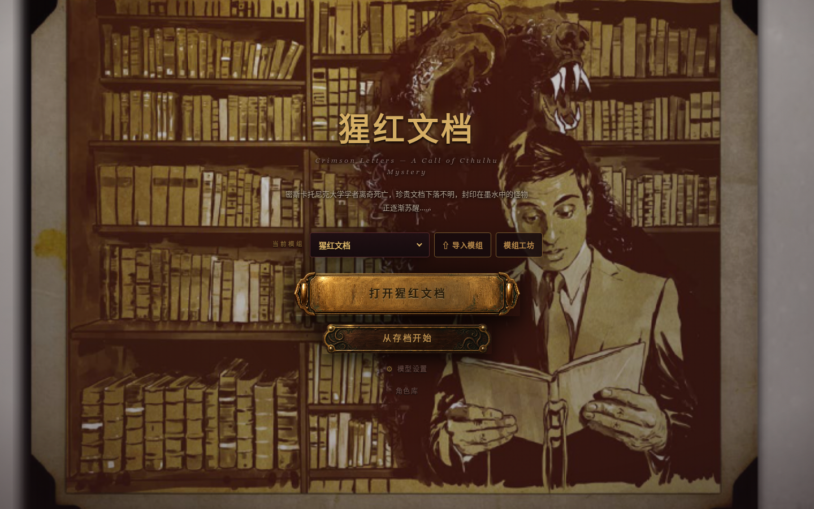
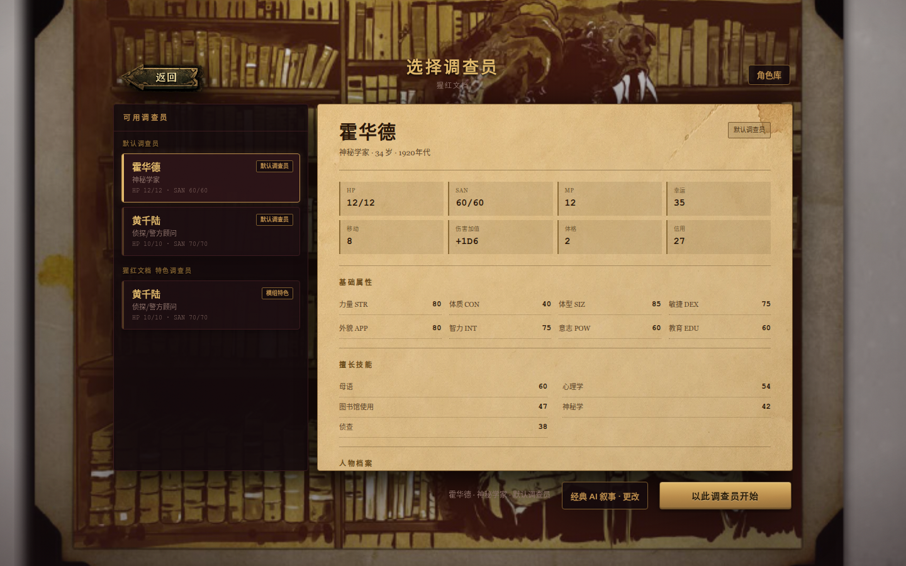
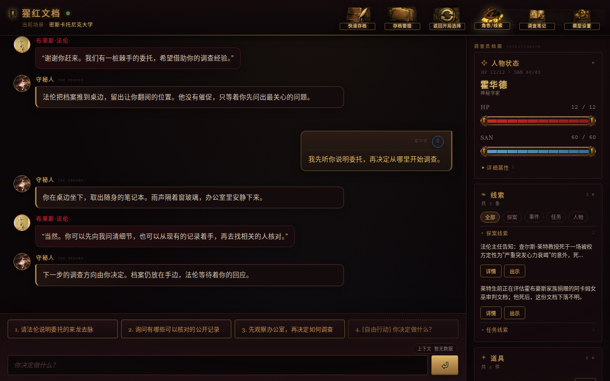
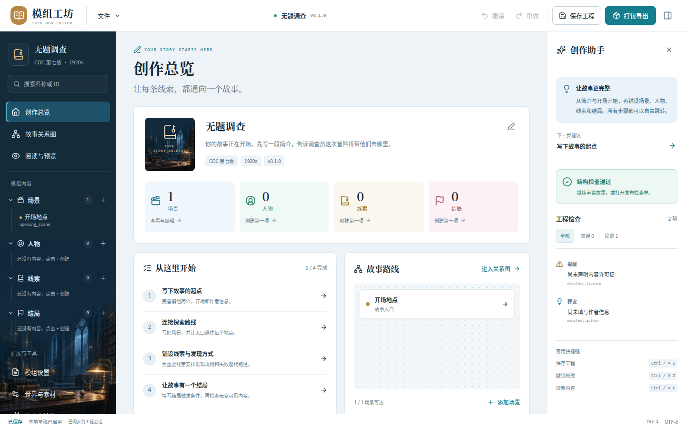

# TRPG Master

[简体中文](README.md) · [English](README.en.md)

**A module-driven tabletop RPG platform with human or AI Keepers, built primarily for Chinese-language Call of Cthulhu investigations.**

Choose a scenario and an investigator, then describe what you want to do. Narration, character dialogue, clues, items, checks and saves share one interface. AI Keepers use restricted tools; the server handles permissions, dice and persistent state.

[Windows downloads](https://github.com/Inaglyite/TRPG-Master/releases/latest) · [Web app](https://trpggame.xyz) · [English guide](docs/en/README.md) · [Module authoring](docs/MODULE_FORMAT.md)



## Start an investigation

1. **Choose a module and investigator.** The repository includes the Chinese scenarios 疯狂宅邸 and 猩红文档. Import additional `.trpgmod` packages or create your own; choose a preset investigator or manage your character collection.
2. **Choose a Keeper.** Classic AI narration provides the existing AI turn flow. Structured play offers human, AI-assisted and AI Keeper modes. Human-hosted play does not require a model API key.
3. **Decide what to do.** Use suggested actions or write your own questions, searches and negotiations. Consult character records and notes, save your progress, or explore a different choice in a branch.

### Features

| Area | What it provides |
| --- | --- |
| Scenarios and authoring | Modules organize scenes, NPCs, clues, discovery conditions and endings; the bundled workshop supports editing and package export |
| Character dialogue | Separate narration and speech bubbles with speaker names and avatar fallbacks, including temporary public-facing characters |
| CoC investigation | Skill checks, bonus/penalty dice, SAN, combat, items and game time, settled through the applicable rules and execution receipts |
| Investigator records | Character sheets, skills, inventory, acquired clues, investigation notes and handouts |
| Saves and branches | Automatic/manual saves, loading feedback, history and branching, with different branch boundaries in each execution mode |
| Clients | Electron desktop, browser-based solo play and multiplayer rooms |
| Keeper tools | A human Keeper console, plus module, private-note, history and execution-receipt queries for agents |

Classic AI turns and structured play use separate execution paths. Their capabilities and acceptance coverage differ; a successful playthrough in one mode does not establish complete coverage in every other mode. See the [project status](docs/STATUS.md) for release and development boundaries.

## Screenshots

<table>
  <tr>
    <td width="50%"><br/><sub>Choose a module or resume a saved investigation</sub></td>
    <td width="50%"><br/><sub>Review an investigator and choose a play mode</sub></td>
  </tr>
  <tr>
    <td width="50%"><br/><sub>Consult character records during play</sub></td>
    <td width="50%"><br/><sub>Organize a scenario in the workshop</sub></td>
  </tr>
</table>

Captured on **2026-10-22** from a local development build with isolated demonstration data, not a player save. The interface is currently in Chinese; released installers may differ from the source shown here.

## Install and run

### Windows

Download the `trpg-game-setup-…-x64.exe` installer or `trpg-game-portable-…-x64.exe` portable application from [GitHub Releases](https://github.com/Inaglyite/TRPG-Master/releases/latest). Choose local or cloud play, then configure a model if your Keeper mode needs one.

### Linux desktop from source

Install **Python 3.12+, Node.js 22 and npm**, then run:

```bash
git clone https://github.com/Inaglyite/TRPG-Master.git
cd TRPG-Master
bash start_desktop.sh
```

The launcher checks dependencies and builds the frontend. It starts the local backend when you choose local play. For a browser development setup and Windows packaging, see the [English guide](docs/en/README.md).

### Models and accounts

Use the in-app model settings to supply a service endpoint, model and API key. `python3 start.py --config` also configures local model access. AI features require a working model service and its associated usage allowance; human-hosted play does not call a model.

Cloud play requires an account and uses the applicable account/world BYOK binding. Joining a room does not expose the Keeper's key or imply free model usage. Keep `.env.json`, keys, databases and real saves out of version control.

## Create modules

Open **模组工坊** (Module Workshop) from the start screen, edit the scenario, export a `.trpgmod` package, then import it into the game for an isolated playtest. The [module template](examples/module-template/) and command-line packager provide another authoring path.

Compatible desktop clients can update the workshop's web component separately from the game. Check from **文件 → 检查编辑器更新** (File → Check editor updates); downloads require the user's choice. See [module authoring](docs/MODULE_FORMAT.md) and the [English guide](docs/en/README.md#module-authoring).

## Documentation and contributions

- [English setup and authoring guide](docs/en/README.md)
- [Chinese documentation index](docs/INDEX.md): architecture, protocol, development, operations, module format and project status
- [Issue tracker](https://github.com/Inaglyite/TRPG-Master/issues): include the version, Keeper mode, reproduction steps and sanitized logs

Test locally. The production service is not a test environment. Keep protocol/schema, documentation and tests in sync when contributing.

Source code is available under the [MIT License](LICENSE).
