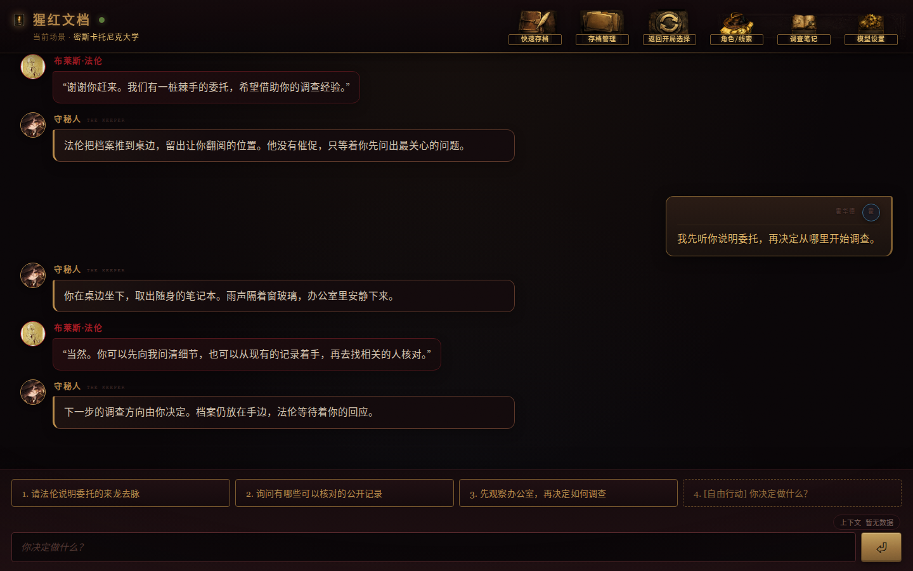
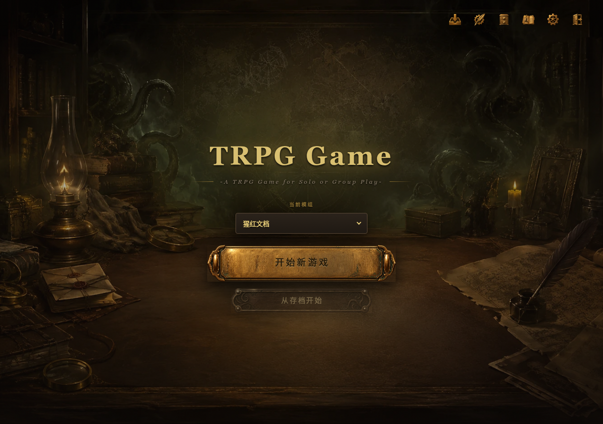
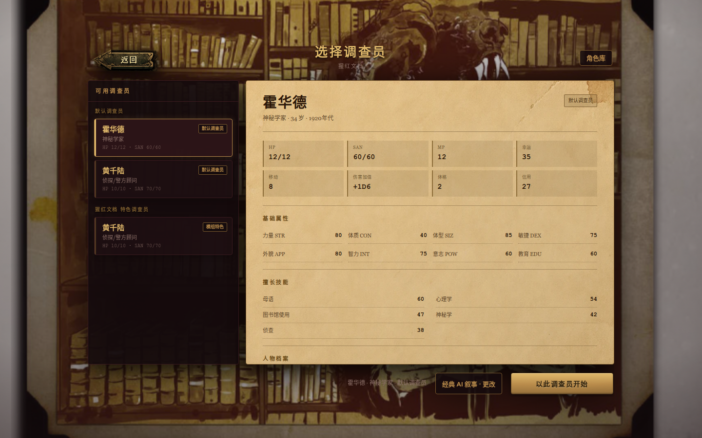
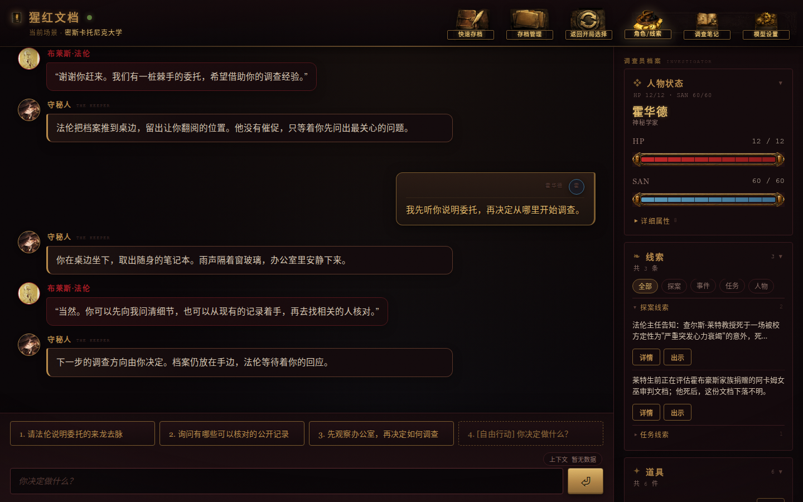
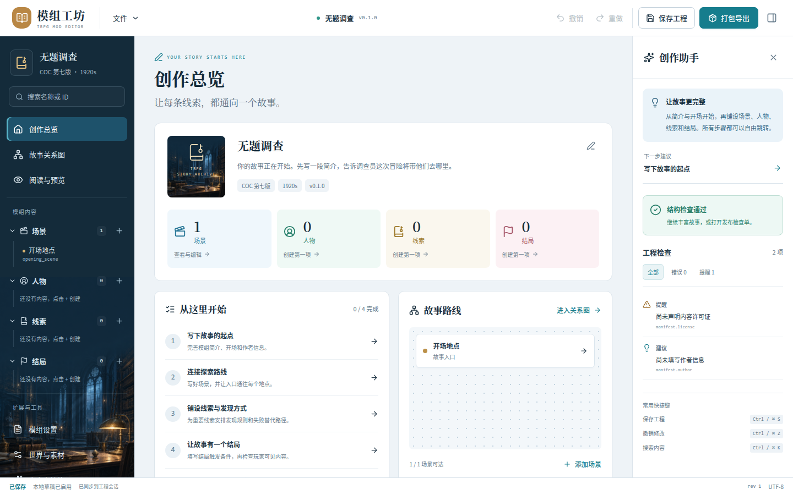

# TRPG Master

[简体中文](README.md) · [English](README.en.md)

**A module-driven tabletop RPG platform with human or AI Keepers, built primarily for Chinese-language Call of Cthulhu investigations.**

Choose a scenario and an investigator, then describe what you want to do. Narration, character dialogue, clues, items, checks and saves share one interface. AI Keepers use restricted tools; the server handles permissions, dice and persistent state.

[Windows downloads](https://github.com/Inaglyite/TRPG-Master/releases/latest) · [Web app](https://trpggame.xyz) · [English guide](docs/en/README.md) · [Module authoring](docs/MODULE_FORMAT.md)

Updated **2026-11-11**, against verified source commit `c56e28dd`. The latest public stable installer is still **v1.0.2**. See [project status](docs/STATUS.md#1-版本与交付范围) for source, CI artifact and deployment versions.



## Start an investigation

1. **Choose a module and investigator.** The repository includes the Chinese scenarios 疯狂宅邸 and 猩红文档. Import additional `.trpgmod` packages or create your own; choose a preset investigator or manage your character collection.
2. **Choose a Keeper.** Classic AI narration provides the existing AI turn flow. Structured play offers human, AI-assisted and AI Keeper modes. Human-hosted play does not require a model API key.
3. **Decide what to do.** Use suggested actions or write your own questions, searches and negotiations. You can hide suggestions in Game settings → Game preferences. Consult character records and notes, save your progress, or explore a different choice in a branch.

### Features

| Area | What it provides |
| --- | --- |
| Scenarios and authoring | Workshop editing, export and in-game imports; local module management can delete an imported version and its associated saves before reimporting |
| Character dialogue | Separate narration and speech bubbles with speaker names and avatar fallbacks, including temporary public-facing characters |
| CoC investigation | Skill checks, bonus/penalty dice, SAN, combat, items and game time, settled through the applicable rules and execution receipts |
| Investigator records | Character sheets, skills, inventory, acquired clues, investigation notes and handouts |
| Saves and branches | Automatic/manual saves, loading feedback, history and branching, with different branch boundaries in each execution mode |
| Clients | Electron desktop, browser-based solo play and multiplayer rooms |
| Keeper tools | A human Keeper console, plus module, private-note, history and execution-receipt queries for agents |
| Investigation toolbar | Below the input: choose an investigator skill, organize the latest turn's clues, or propose travel on a visited-location map |
| Game settings | Separate game preferences, model configuration and context tabs; optional display of action suggestions |

Skill actions go to the Keeper for adjudication. Clue organization produces an editable draft with original quotes for your private investigation notes. The map shows only locations the party has reached. Automatic note extraction calls your configured model; manual excerpts are also available.

Classic AI turns and structured play use separate execution paths. Their capabilities and acceptance coverage differ; a successful playthrough in one mode does not establish complete coverage in every other mode. See the [project status](docs/STATUS.md) for release and development boundaries.

## Screenshots

<table>
  <tr>
    <td width="50%"><br/><sub>Choose a module; access importing, the workshop, module management, characters and settings in the top-right corner</sub></td>
    <td width="50%"><br/><sub>Review an investigator and choose a play mode</sub></td>
  </tr>
  <tr>
    <td width="50%"><br/><sub>Consult character records during play</sub></td>
    <td width="50%"><br/><sub>Organize a scenario in the workshop</sub></td>
  </tr>
</table>

The start-screen image was captured on **2026-11-08**; the other images are from **2026-10-22**. All use local development builds and isolated demonstration data. The interface is currently in Chinese. See [screenshot provenance](docs/screenshots/README.md); the images do not establish which features a released installer includes.

## Install and run

### Windows

Download the `trpg-game-setup-…-x64.exe` installer or `trpg-game-portable-…-x64.exe` portable application from [GitHub Releases](https://github.com/Inaglyite/TRPG-Master/releases/latest). Choose local or cloud play, then configure a model if your Keeper mode needs one.

The stable installer may not include the newest source features described here. Use the source setup for those features, or consult [status](docs/STATUS.md#1-版本与交付范围) for verified Windows CI artifacts. A successful CI build is not a new stable release.

### Linux desktop from source

Install **Python 3.12+, Node.js 22 and npm**, then run:

```bash
git clone https://github.com/Inaglyite/TRPG-Master.git
cd TRPG-Master
bash start_desktop.sh
```

The launcher checks dependencies and builds the frontend. It starts the local backend when you choose local play. For a browser development setup and Windows packaging, see the [English guide](docs/en/README.md).

### Models and accounts

Use **游戏设置 → 模型配置** (Game settings → Model configuration) to supply a service endpoint, model and API key. Older clients call the entry 模型设置 (Model settings). `python3 start.py --config` also configures local model access. AI features require a working model service and its associated usage allowance. Core human-hosted play does not call a model; optional automatic clue organization does.

Common provider presets and three API formats are available: **Chat Completions,
Anthropic Messages, and Responses**. Endpoints and model IDs remain editable;
connection tests verify streaming and, for the judgement role, tool calling.
See the [configuration guide](docs/en/README.md#model-configuration).

Cloud play requires an account and uses the applicable account/world BYOK binding. Joining a room does not expose the Keeper's key or imply free model usage. Keep `.env.json`, keys, databases and real saves out of version control.

### Start-screen tools and suggestions

Small icons in the top-right corner provide module import, the workshop, local module management, the character library and game settings; desktop clients also have an exit control. Hover for labels.

- **Delete and reimport:** In local mode, open 模组管理 (Module management). Deleting an imported version permanently removes all its timelines, automatic/manual saves and turn history. Reimporting does not recover that progress. Character-library records, workshop projects and other versions remain. Built-in and currently used modules are protected. See [module management](docs/en/README.md#module-management).
- **Hide suggestions:** Turn off 显示行动提示 (Show action suggestions) under 游戏设置 → 游戏偏好 (Game settings → Game preferences). This hides the narrative action menu and bottom suggestions, while free input and required confirmations/checks remain. It is a local display preference and does not rewrite saves or model output.

## Create modules

Open **模组工坊** (Module Workshop) from the start screen, edit the scenario, export a `.trpgmod` package, then import it into the game for an isolated playtest. The [module template](examples/module-template/) and command-line packager provide another authoring path.

Compatible desktop clients can update the workshop's web component separately from the game. Check from **文件 → 检查编辑器更新** (File → Check editor updates); downloads require the user's choice. See [module authoring](docs/MODULE_FORMAT.md) and the [English guide](docs/en/README.md#module-authoring).

## Troubleshooting

Include the build/installer version, Keeper mode, module, reproduction steps and incident time in a report. The backend writes `trpg.log` and per-turn `diagnostics.jsonl`; [the English guide](docs/en/README.md#diagnostic-logs) explains their locations and history searches. Logs can contain story spoilers and personal information, and cannot recover dialogue from before logging was introduced. Inspect and sanitize them before sharing.

```bash
python tools/diagnose_turn.py --list-turns
python tools/diagnose_turn.py --search "text from the screenshot"
```

## Documentation and contributions

- [English setup and authoring guide](docs/en/README.md)
- [Chinese documentation index](docs/INDEX.md): architecture, protocol, development, operations, module format and project status
- [Issue tracker](https://github.com/Inaglyite/TRPG-Master/issues): include the version, Keeper mode, reproduction steps and sanitized logs

Test locally. The production service is not a test environment. Keep protocol/schema, documentation and tests in sync when contributing.

Source code is available under the [MIT License](LICENSE).
