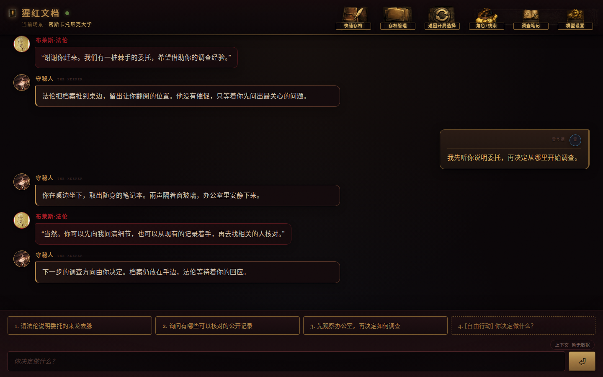
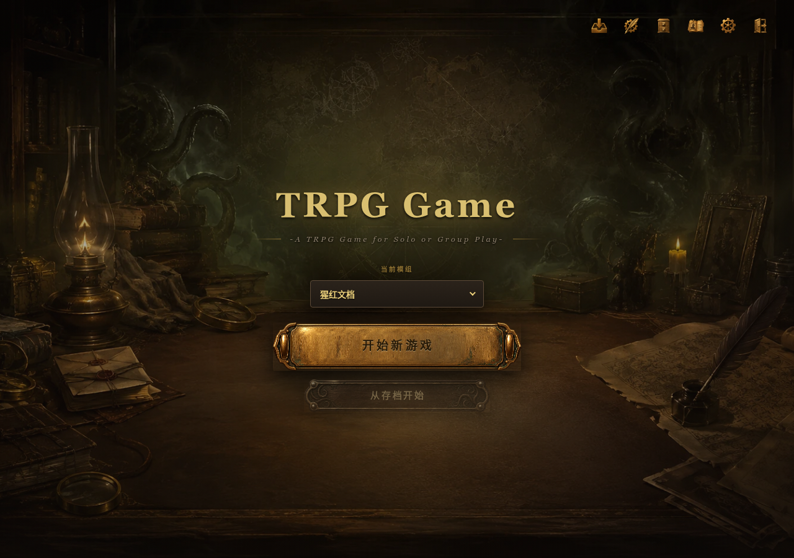
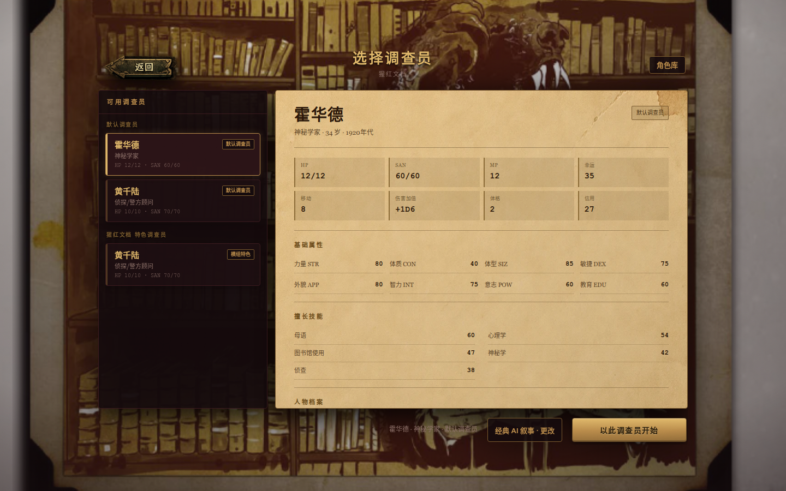
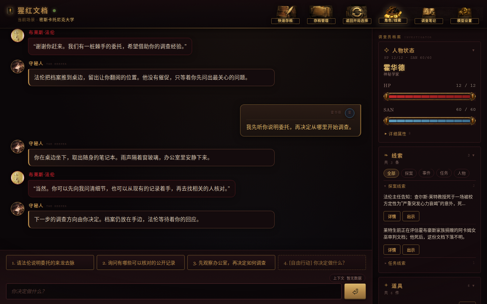
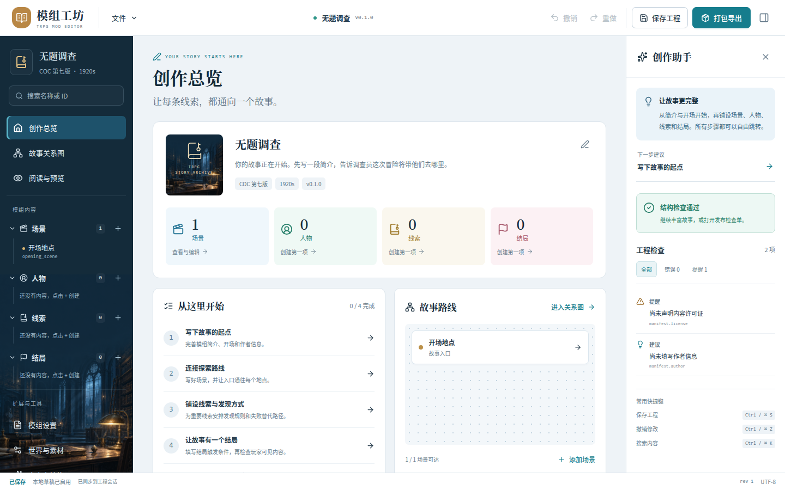

# TRPG Master

[简体中文](README.md) · [English](README.en.md)

**以模组驱动的中文线上跑团平台，让 AI 或人类担任守秘人。**

选择模组与调查员，用自然语言决定下一步。场景、人物对白、线索、道具、检定与存档在同一处呈现；AI 通过受限工具主持，服务端负责掷骰、权限和状态结算。当前主要围绕《克苏鲁的呼唤》（CoC）的调查玩法开发。

[下载 Windows 客户端](https://github.com/Inaglyite/TRPG-Master/releases/latest) · [浏览器入口](https://trpggame.xyz) · [上手与开发](docs/DEVELOPMENT.md) · [制作模组](docs/MODULE_FORMAT.md)

文档更新于 **2026-11-11**，功能说明以已验证的源码 `c56e28dd` 为基线。公开稳定安装包仍为 **v1.0.2**；源码、CI 构建产物与正式服务的版本范围见[项目状态](docs/STATUS.md)。



## 从一场调查开始

1. **选择模组与调查员。** 仓库附带「疯狂宅邸」「猩红文档」，也支持导入 `.trpgmod` 模组包；可以使用预设调查员或管理自己的角色。
2. **决定谁来主持。** 经典 AI 叙事适合直接开始个人调查；结构化模式提供人类主持、AI 辅助主持和 AI 主持入口。人类主持无需模型 Key。
3. **用自己的方式行动。** 选项只是建议，你也可以自由提问、搜查、交涉或提出其他做法；在“游戏设置 → 游戏偏好”中可关闭行动提示。过程中查阅人物、线索和调查笔记，保存进度，或创建分支尝试不同选择。

### 主要功能

| 能力 | 使用方式 |
| --- | --- |
| 模组与创作 | 工坊编辑、导出，游戏内导入试玩；本地模组管理可删除导入版本及其对应存档后重新导入 |
| 人物对话 | 旁白与人物台词分开显示，按身份匹配姓名、头像与气泡；临时人物也可使用公开称呼发言 |
| CoC 调查 | 技能检定、奖励/惩罚骰、SAN、战斗、物品与案件时间由对应规则和执行回执结算 |
| 调查员与资料 | 角色档案、属性技能、物品、已获线索、调查笔记与资料图片 |
| 存档与时间线 | 自动/手动存档、读取反馈、历史回顾与分支；具体分叉范围随运行模式不同 |
| 多种客户端 | Electron 本地桌面、浏览器云端单人，以及多人房间 |
| 主持工具 | 人类主持工作台，以及供 Agent 查询的模组资料、私有笔记、历史和执行回执 |
| 调查行动栏 | 输入框下选择人物技能、整理本轮线索，或通过已探索地图提出移动 |
| 游戏设置 | 游戏偏好、模型配置和上下文分别分页；可关闭“你可以——”及底部行动建议 |

“使用技能”会连同行动目标交给主持判断是否需要检定；“整理线索”先生成带原文的草稿，确认后加入私人调查笔记；“场景移动”只显示队伍已经抵达的地点。自动整理会调用配置的模型，也可手动摘录。

经典 AI 回合与结构化主持使用不同执行路径，功能和验收覆盖仍有差异。当前开发、正式发布和待完善项目分别记录在[项目状态](docs/STATUS.md)，不将一种模式的通过结果等同于全部模式完成。

## 界面预览

<table>
  <tr>
    <td width="50%"><br/><sub>选择模组；右上角集中导入、工坊、管理、角色库与设置入口</sub></td>
    <td width="50%"><br/><sub>选择调查员，查看档案并设置游玩方式</sub></td>
  </tr>
  <tr>
    <td width="50%"><br/><sub>在游戏中查阅属性、线索和物品</sub></td>
    <td width="50%"><br/><sub>在模组工坊中组织自己的故事</sub></td>
  </tr>
</table>

开始页截图摄于 **2026-11-08**，其他截图摄于 **2026-10-22**，来自本地开发版与隔离演示数据，不包含玩家存档。界面为中文；截图来源和版本范围见[截图说明](docs/screenshots/README.md)。

## 安装与启动

### Windows：直接使用安装包

到 [GitHub Releases](https://github.com/Inaglyite/TRPG-Master/releases/latest) 下载 `trpg-game-setup-…-x64.exe` 安装版，或 `trpg-game-portable-…-x64.exe` 便携版。首次启动后选择本地或云端游戏，并按所选主持方式配置模型。

稳定版未必包含下述最新源码功能。需要试用最新源码时按开发说明启动；Windows CI 产物及其验证结果可从[项目状态](docs/STATUS.md#1-版本与交付范围)找到，CI 构建成功不等于已经发布新的稳定版。

### Linux：从源码启动桌面版

准备 **Python 3.12+、Node.js 22 和 npm**，然后执行：

```bash
git clone https://github.com/Inaglyite/TRPG-Master.git
cd TRPG-Master
bash start_desktop.sh
```

启动器检查依赖并构建前端；选择本地游戏后启动本地后端。源码开发、浏览器本地运行、数据库迁移及 Windows 打包见[开发说明](docs/DEVELOPMENT.md)。

### 模型与账号

通过 **“游戏设置 → 模型配置”** 配置服务地址、模型和 Key；旧版入口名为“模型设置”。也可使用 `python3 start.py --config` 配置本地模型。人类主持核心流程不调用模型；AI 主持和自动整理线索等辅助功能需要可用的模型配置及服务额度。

模型配置提供 DeepSeek、Kimi、通义千问、智谱、豆包、Gemini、OpenAI、OpenRouter、硅基流动等预设。
厂商与接口格式可分别选择：支持 **Chat Completions、Anthropic Messages、Responses**，
自定义地址和模型 ID 仍可编辑。测试连接实际验证流式生成，裁决模型另测工具调用；
服务提供模型列表时可在模型 ID 输入框选择。账户须有对应模型的访问权限。

云端需要账号，并使用对应账号/世界的 BYOK 绑定。加入房间不等于获得主持人的密钥；费用归属取决于实际使用的模型绑定。`.env.json`、API Key、数据库和真实存档不要提交到版本库。

### 开始页工具与行动提示

开始页右上角以一排图标集中提供导入模组、模组工坊、模组管理、角色库和游戏设置，桌面客户端另有退出入口；悬停可查看名称。

- **删除后重新导入：** 本地模式打开“模组管理”，选中已导入版本并确认删除。该版本的所有时间线、自动/手动存档和回合记录会一并永久删除，重新导入不会恢复进度；角色库、工坊工程和其他版本保留。内置或正在使用的模组不能删除，详见[模组管理](docs/MODULE_FORMAT.md#删除并重新导入)。
- **隐藏行动建议：** 在“游戏设置 → 游戏偏好”关闭“显示行动提示”。立即隐藏正文的“你可以——”和底部建议按钮，自由输入、必要确认与检定交互保留。偏好保存在本机，重新开启可恢复显示，不改写模型输出或存档。

## 创作自己的模组

在开局页点击 **「模组工坊」**，编辑场景、人物、线索与主持资料，导出 `.trpgmod` 后导入游戏，在独立世界试玩。也可以从 [module-template](examples/module-template/) 开始，用命令行编译、打包和校验。

支持独立更新机制的桌面版本，可在工坊提示后选择更新编辑器；「文件 → 检查编辑器更新」也可主动检查。兼容的编辑器网页更新无需每次重发整个游戏安装包。格式、素材和运行边界见[模组作者入口](docs/MODULE_FORMAT.md)。

## 遇到问题时

反馈时附上提交/安装包版本、主持方式、所在模组、复现步骤和发生时间。后端提供 `trpg.log` 与按回合关联的 `diagnostics.jsonl`；日志位置、历史回合查询和截图文字搜索见[日志排障](docs/DEVELOPMENT.md#按回合查看开发日志)。日志不会补录升级前的对话，可能含剧情和个人信息，分享前需检查并脱敏。

开发环境中可先列出仍保留的回合，再按截图中的文本定位：

```bash
python tools/diagnose_turn.py --list-turns
python tools/diagnose_turn.py --search "截图中的一句话"
```

## 文档与参与开发

| 文档 | 内容 |
| --- | --- |
| [开发与上手](docs/DEVELOPMENT.md) | 环境准备、浏览器/桌面启动、测试与协作 |
| [模组作者入口](docs/MODULE_FORMAT.md) | 工坊、模板、格式、导入与验收 |
| [架构](docs/ARCHITECTURE.md) | 两种执行路径、状态、上下文与记忆 |
| [协议](docs/PROTOCOL.md) | 请求、命令、事件、权限与恢复 |
| [运维](docs/OPERATIONS.md) | 配置、备份、环境隔离与发布 |
| [项目状态](docs/STATUS.md) | 已发布范围、开发进展和已知限制 |
| [English documentation](docs/en/README.md) | English setup, play modes and module authoring guide |

完整入口见[文档索引](docs/INDEX.md)。欢迎通过 [Issues](https://github.com/Inaglyite/TRPG-Master/issues) 提交问题：附上版本、主持方式、复现步骤和脱敏日志，会更容易定位。

开发测试在本地进行，正式服务不用于测试。玩法或协议修改应同步对应文档与测试；完整开发和发布规则见上述文档。

项目源码采用 [MIT License](LICENSE)。
